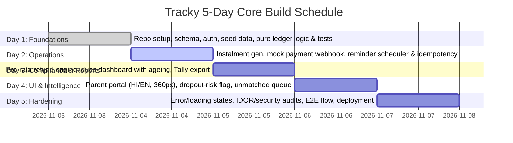
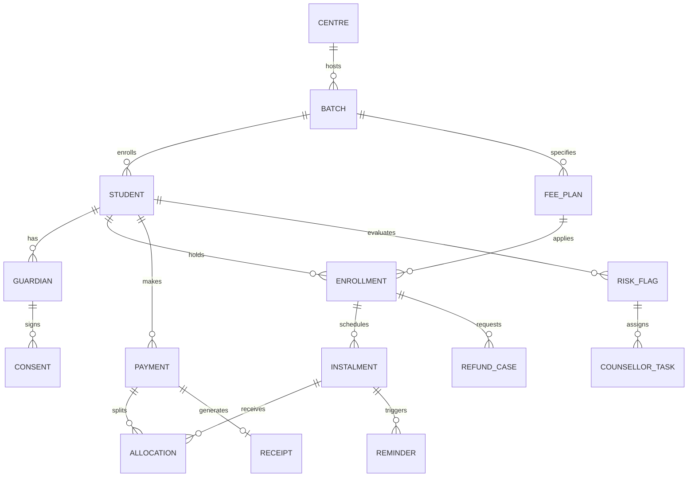
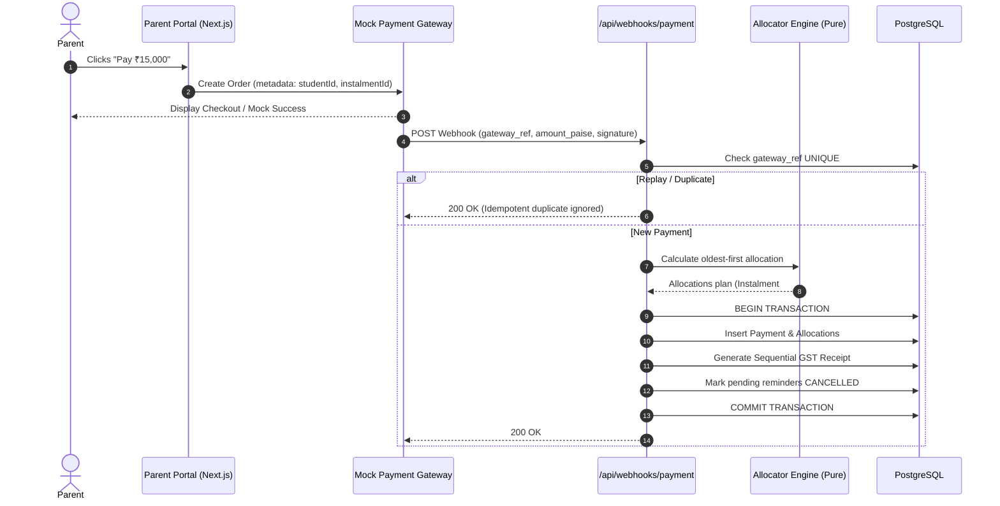

# High-Level Design (HLD): Tracky Fee Ledger, Parent Portal & Dues Dashboard

**Document Version:** 1.0.0  
**Status:** Approved Architecture Draft  
**Target Architecture:** Next.js (App Router), TypeScript, Tailwind CSS, PostgreSQL, Prisma  
**Execution Horizon:** 5-Day Modular Monolith MVP  

---

## 1. Executive Summary & Objective

**Tracky** is a high-reliability fee collection, student financial ledger, and dues management platform designed for educational coaching institutes and multi-centre academic operations. The system bridges the critical operational gap between institute accounts teams and parents, replacing manual reconciliation and aggressive follow-ups with automated, transparent, and legally compliant workflows.

### Core Objectives
1. **Financial Integrity & Double-Entry Invariants:** Maintain an append-only, immutable financial ledger where payment status is derived rather than stored as mutable state. All currency calculations use integer paise (`BIGINT`).
2. **Frictionless Parent Experience:** Provide a zero-friction, mobile-first parent portal accessible on low-end devices and spotty networks, featuring Hindi/English bilingual support and one-tap payment options.
3. **Idempotent Automated Collections:** Dispatch multi-channel reminders (T-3, T0, T+3, T+7) that immediately halt the exact instant a payment is verified, preventing harassment.
4. **Transparent Regulatory Compliance:** Comply with the **Digital Personal Data Protection (DPDP) Act 2023** (explicit consent tracking) and **Ministry of Education Coaching Guidelines** (published refund policy, 10-day refund settlement tracking).
5. **Ethical AI Dropout-Risk Diagnostics:** Provide transparent, explainable dropout risk indicators derived from payment delays, attendance dips, and test score trends—strictly isolated from financial operations and parent-facing messaging.

---

## 2. Scope & 5-Day Delivery Plan

To maximize execution velocity while ensuring uncompromising financial reliability, the initial 5-day build focuses on a tightly scoped core slice:

| Capability / Module | In Scope (5-Day Core Build) | Out of Scope (Next Steps Roadmap) |
| :--- | :--- | :--- |
| **Fee Ledger** | Student fee plans, instalments, discounts, append-only payments, derived balance, days overdue | Bulk attendance/test score CSV uploads, full scorecard PDFs |
| **Parent Portal** | Mobile-first portal, phone OTP login, dues breakdown, mock gateway pay link, GST receipts | Native Android/iOS apps, payment gateway live credentials |
| **Reminders** | Scheduled triggers (T-3, T0, T+3, T+7), stop-on-paid guard, Hindi/English templates, delivery logs | Real WhatsApp Business API / SMS gateway integration (DLT registration) |
| **Refund Engine** | Versioned refund policy engine, step-by-step pro-rata calculator, 10-day SLA case tracking | Automated bank payouts / reverse webhook fund disbursement |
| **Dues Dashboard** | Centre/batch analytics, ageing buckets (0–30, 31–60, 60+ days), ledger drilldown | Live bi-directional Tally sync (simplified XML/CSV voucher export instead) |
| **Dropout Risk** | Rule-based heuristic scoring (0–100), LLM plain-language explanation, counsellor task creation | Auto-retraining ML models, deep neural networks |
| **Reconciliation** | Accounts executive queue for unmatched payments, manual match/reject | Automated bank statement OCR ingestion |

### 5-Day Delivery Roadmap



---

## 3. Technology Stack & Architectural Rationale

| Layer | Selected Technology | Architectural Rationale |
| :--- | :--- | :--- |
| **Framework** | **Next.js 15+ (App Router)** | Full-stack unified TypeScript codebase combining Server Components, Route Handlers, and Server Actions without split frontend/backend overhead. |
| **Language** | **TypeScript 5+** | End-to-end type safety across domain logic, database queries, and client components. |
| **Styling** | **Tailwind CSS v4** | Rapid token-driven design system enforcing a restrained, high-contrast, accessible palette suitable for low-end devices. |
| **Database** | **PostgreSQL (via Supabase)** | Relational ACID guarantees, row-level locking, partial indices, native `BIGINT` support for integer paise, and strict constraints. |
| **ORM** | **Prisma ORM** | Type-safe migrations, auto-generated TypeScript query client, and transparent transaction management (`prisma.$transaction`). |
| **Testing** | **Vitest & Playwright** | Fast unit tests for pure financial/allocation rules via Vitest; browser-level E2E coverage for the parent payment loop via Playwright. |
| **Background Jobs** | **Vercel Cron / GitHub Actions** | Lightweight, zero-maintenance scheduled webhook triggers for daily reminder runs. |
| **Internationalization** | **Lightweight Dictionary (`en`/`hi`)** | Zero-bundle-overhead dictionary approach stored per locale, avoiding bulky i18n runtimes on 2G/3G mobile devices. |

---

## 4. System Architecture & Modular Monolith Design

Tracky is architected as a **Modular Monolith** with explicit boundaries. Domain modules (Ledger, Refunds, Risk Scoring) are designed as pure, side-effect-free functions that accept typed input states and return deterministic results, making them universally testable and mathematically verifiable.

```
src/
 ├─ app/                         # Next.js App Router (Pages, Layouts, Route Handlers)
 │   ├─ (auth)/                  # Staff login & Parent OTP authentication
 │   ├─ (parent)/                # Mobile-first parent portal (/parent/dues, /parent/receipts)
 │   ├─ (staff)/                 # Accounts & Counsellor dashboard (/dashboard, /unmatched, /refunds)
 │   └─ api/                     # Webhooks & Cron triggers (/api/webhooks/payment, /api/cron/reminders)
 ├─ modules/                     # Core Business Logic Modules (Encapsulated)
 │   ├─ auth/                    # RBAC, session management, DPDP consent enforcement
 │   ├─ ledger/                  # Pure allocation logic, balance calculation, overdue math
 │   ├─ refunds/                 # Versioned pro-rata refund calculations
 │   ├─ reminders/               # Reminder scheduler, template engines (HI/EN), stop-on-paid guard
 │   ├─ payments/                # Payment gateway adapter & signature verification
 │   ├─ reconcile/               # Unmatched payments queue & Tally export generator
 │   └─ risk/                    # Dropout risk heuristic scoring & counsellor tasks (Strictly Isolated)
 ├─ adapters/                    # External Interfaces & I/O
 │   ├─ gateway/                 # Mock payment gateway (Razorpay test mode compatible)
 │   ├─ messaging/               # Mock SMS/WhatsApp delivery logger
 │   └─ tally/                   # Simplified Tally XML/CSV voucher export adapter
 ├─ lib/                         # Shared utilities, Prisma client, Zod schemas
 └─ types/                       # Shared domain TypeScript interfaces
```

### Module Isolation Boundary: The Zero-Touch Money Invariant

> [!IMPORTANT]
> **Strict Architectural Boundary:** The `risk/` module (AI/Heuristics) has **zero imports** from `ledger/` write routines, `payments/`, or `reminders/`. An automated Vitest lint/import test asserts that no code path exists where a risk score can alter balances, initiate fee demands, or dispatch parent reminders.

---

## 5. Core Data Model & ER Schema

All monetary values are strictly stored as `BIGINT` representing integer **paise** (1 INR = 100 paise) to prevent floating-point rounding errors.



### Table Definitions & Constraints

1. **`centres`**: Physical branch locations (`id`, `name`, `city`, `gstin`, `created_at`).
2. **`batches`**: Academic cohorts (`id`, `centre_id`, `name`, `course_start`, `course_end`).
3. **`students`**: Student records (`id`, `name`, `batch_id`, `date_of_birth`, `status` [ACTIVE/LEFT], `left_on`).
4. **`guardians`**: Parent/guardian contact details (`id`, `student_id`, `name`, `phone`, `email`, `relation`, `preferred_lang` [HI/EN]).
5. **`consents`**: DPDP Act 2023 audit record (`id`, `guardian_id`, `student_id`, `notice_version`, `granted_at`, `ip_address`, `withdrawn_at`).
6. **`fee_plans`**: Master fee structure per batch (`id`, `batch_id`, `total_paise`, `registration_paise`, `instalment_count`).
7. **`enrollments`**: Student plan linkage (`id`, `student_id`, `plan_id`, `discount_paise`, `discount_reason`).
8. **`instalments`**: Scheduled fee tranches (`id`, `enrollment_id`, `seq`, `amount_paise`, `due_date`, `grace_days`). *Status is derived.*
9. **`payments`**: Append-only transaction log (`id`, `student_id`, `amount_paise`, `source`, `gateway_ref` **UNIQUE**, `received_at`, `status` [MATCHED/UNMATCHED]).
10. **`allocations`**: Append-only distribution table (`id`, `payment_id`, `instalment_id`, `amount_paise`, `created_at`).
11. **`receipts`**: Sequential GST tax receipts (`id`, `payment_id`, `receipt_no` **UNIQUE**, `gstin`, `taxable_paise`, `gst_paise`, `issued_at`).
12. **`reminders`**: Notification log (`id`, `instalment_id`, `template_key`, `scheduled_for`, `sent_at`, `status`, **UNIQUE(instalment_id, template_key, scheduled_for)**).
13. **`refund_policies`**: Versioned refund rules (`id`, `version`, `effective_from`, `rules_json`, `published_at`).
14. **`refund_cases`**: Student exit refund tracking (`id`, `enrollment_id`, `leave_date`, `computed_paise`, `policy_version`, `status`, `paid_by_date`).
15. **`risk_flags`**: AI risk diagnostics (`id`, `student_id`, `score`, `reasons_json`, `created_at`, `status` [OPEN/CONFIRMED/FALSE_FLAG], `reviewed_by`).
16. **`counsellor_tasks`**: Intervention queue (`id`, `student_id`, `flag_id`, `assignee_id`, `due_date`, `status`).
17. **`audit_log`**: Immutable audit trail (`id`, `actor_id`, `action`, `entity_type`, `entity_id`, `before_state`, `after_state`, `created_at`).

---

## 6. Critical Financial Invariants & Design Decisions

### Invariant 1: Append-Only Ledger & Derived Paid Status
- Under no circumstances is an `instalments.status` or `payments.amount_paise` modified in place.
- An instalment's paid status and remaining balance are **purely derived** by summing all matching rows in `allocations`:
  $$\text{Balance}(\text{instalment}) = \text{amount\_paise} - \sum \text{allocations.amount\_paise}$$
- A student's total outstanding balance is a single aggregate query over all open instalments minus allocations.
- Financial corrections and refunds are recorded as reverse ledger entries, preserving complete forensic auditability.

### Invariant 2: Webhook Idempotency
- Payment gateways may retry webhooks multiple times. The unique constraint on `payments.gateway_ref` guarantees that duplicate webhook deliveries are safely rejected or treated as idempotent no-ops inside a single database transaction.

### Invariant 3: Scheduler Idempotency & Stop-On-Paid Guard
- Reminders are governed by a unique constraint on `(instalment_id, template_key, scheduled_for)`. Running the reminder scheduler multiple times within a day produces zero redundant messages.
- **Double-Check Rule:** Before dispatching any reminder message, the worker re-queries the instalment's derived balance in real-time. If the balance is zero or less, the reminder is transitioned to `CANCELLED` immediately.

---

## 7. Main Core Flows & Workflows

### Flow A: Payment Lifecycle & Balance Allocation


### Flow B: Automated Dues Reminders
- **Schedule:** Triggers at T-3 (3 days before due date), T0 (on due date), T+3 (grace period expiry), and T+7 (escalation).
- **Execution:** Daily batch job queries all unpaid instalments where `due_date + offset == today`.
- **Bilingual Delivery:** Retrieves `guardians.preferred_lang` (defaults to English, toggles to Hindi).
- **Safety Check:** Evaluates `isInstalmentPaid(instalment_id)`. If paid, logs `SUPPRESSED_PAID` and terminates.

### Flow C: Pro-Rata Refund Engine
- **Policy Versioning:** The refund policy is versioned (e.g. `v2026.1`). Cases store the exact policy version active on the student's `leave_date`.
- **Default Regulatory Formula:**
  $$\text{Refund} = \max\left(0, (\text{Amount Paid} - \text{Registration Fee}) \times \frac{\text{Remaining Course Days}}{\text{Total Course Days}}\right)$$
  *(Subject to a configurable 7-day initial cooling-off window; registration fee is strictly non-refundable).*
- **10-Day SLA Enforcement:** Under Ministry guidelines, institutes must settle refunds within 10 days of exit. Tracky automatically assigns `paid_by_date = leave_date + 10 days` and surfaces an amber/red breach countdown on the staff dashboard.

### Flow D: AI Dropout-Risk Diagnostics
- **Heuristic Scoring Model:** Evaluates three explainable features:
  1. Days overdue on fee instalments (Weight: 45%)
  2. Attendance slope over trailing 4 weeks (Weight: 35%)
  3. Internal test score trajectory (Weight: 20%)
- **LLM Explanation:** An LLM generates a concise, 2-sentence rationale for institute counsellors (e.g., *"Student missed 2 consecutive instalments and attendance dropped by 40% in Mathematics during October"*).
- **Audit & Human-in-the-Loop:** Counsellor reviews task and marks `CONFIRMED` or `FALSE_FLAG`. Accuracy metrics are exposed on the staff dashboard.

---

## 8. UI/UX Specifications

### 1. Parent Portal (Mobile-First)
- **Viewport Target:** Strictly tested for low-end Android displays down to **360px width**.
- **Hero Card:** Above-the-fold contains exactly one primary visual card:
  - Total Amount Due (e.g., `₹15,000`)
  - Due Date (e.g., `Due 10 Oct 2026` or `Overdue by 23 days` in high-contrast warning red)
  - Single, full-width high-contrast **"Pay Now"** button.
- **Language Switcher:** Sticky Hindi/English toggle in the top-right header with zero layout shift.
- **Receipts:** Clean, downloadable PDF/HTML tax receipts sorted chronologically below the fold.

### 2. Staff Accounts Dashboard
- **Ageing Analysis Table:** Organizes overdue amounts across industry-standard ageing buckets:
  - `Current (0–30 Days)`
  - `Critical (31–60 Days)`
  - `Default Risk (60+ Days)`
- **Key Target Metric:** Visual progress indicator tracking institute objective: **< 12% total dues over 60 days**.
- **Tally Export:** Single-click file export generating simplified Tally voucher records for financial accounting.

---

## 9. Security, Privacy & Regulatory Compliance

1. **Authentication:**
   - **Staff:** Email + password secured with Argon2/bcrypt hashing and secure HTTP-only cookies.
   - **Parents:** Passwordless Phone OTP with rate-limiting (3 attempts / 15 minutes) and 5-minute expiry. (Mocked clearly in development mode).
2. **Access Control & IDOR Guard:**
   - Every database query in parent endpoints is scoped strictly to the authenticated `guardian_id`. Attempting to query another student's ledger via ID manipulation returns a strict `403 Forbidden`.
3. **DPDP Act 2023 Compliance:**
   - Notice of data collection recorded prior to student ledger viewing.
   - Withdrawal of consent recorded and instantly suppresses all automated marketing and non-essential reminder messages.
4. **GST Regulations:**
   - Every receipt captures institute GSTIN, recipient name, taxable value, CGST (9%), SGST (9%), and unique sequential invoice numbers.

---

## 10. Verification & Testing Strategy

| Test Suite | Priority | Target Behaviors Verified |
| :--- | :--- | :--- |
| **Unit Tests (Vitest)** | **P0 (Critical)** | - Oldest-first allocation order with exact integer math<br>- Partial payments and overpayment distribution<br>- Pro-rata refund boundary conditions (Day 0, final day, post-course)<br>- Stop-on-paid reminder suppression<br>- Static assertion: `risk/` has zero dependencies on `ledger/` writes |
| **Integration Tests** | **P0 (Critical)** | - Gateway webhook replay produces exactly one payment record<br>- Scheduler executed twice in same day dispatches zero duplicate reminders |
| **Security Tests** | **P1 (High)** | - IDOR cross-guardian student record access blocked<br>- Unauthenticated access rejection on all staff/parent routes |
| **E2E Tests (Playwright)** | **P1 (High)** | - Full loop: Parent logs in $\rightarrow$ views dues $\rightarrow$ executes mock payment $\rightarrow$ balance becomes 0 $\rightarrow$ reminder marked cancelled |

---

## 11. Initial Seed Data Verification Check

The seed data includes benchmark student **`STU-0587`**:
- **Total Fee:** ₹30,000
- **Paid to Date:** ₹15,000
- **Due Date:** `2026-10-10`
- **Reference Date:** `2026-11-02`
- **Calculated Overdue:** **23 days overdue**
- **Test Assertion:** System tests must assert that `STU-0587` is accurately grouped into the `0–30 days` ageing bucket with an outstanding balance of ₹15,000 (1,500,000 paise).
