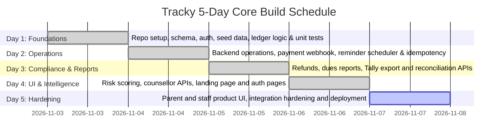
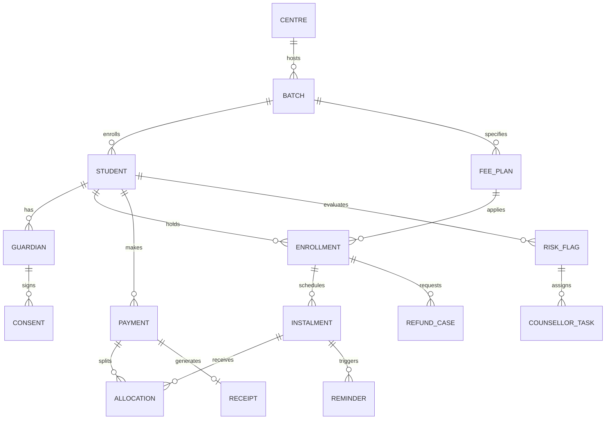
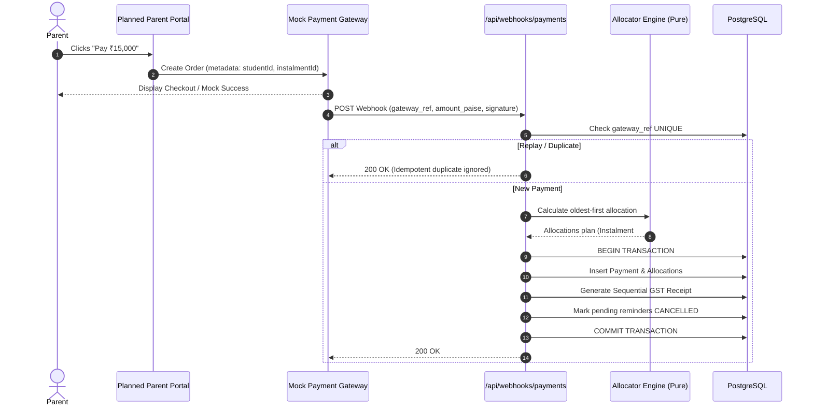

# High-Level Design (HLD): Tracky Fee Ledger, Parent Portal & Dues Dashboard

**Document Version:** 1.1.0
**Status:** Current-state architecture and product direction (2026-11-07)
**Target Architecture:** Next.js 16 App Router, TypeScript, Tailwind CSS v4, PostgreSQL, Prisma
**Execution Horizon:** MVP implementation in progress

> **Implementation status:** This document describes both the implemented backend and planned product behavior. The current app has a marketing landing page and login/signup pages, plus backend APIs for authentication, parent dues/payments/receipts, staff operations, reminders, and risk workflows. The parent and staff product pages are not yet implemented. Items described as target UX or roadmap are plans, not shipped UI. See [`frontend-actions-and-routes.md`](./frontend-actions-and-routes.md) for the page and action plan.

### Current implementation notes (source of truth)

These notes and the explicit target/planned labels below qualify any design language that describes features more strongly than the code currently supports:

- **Routes/UI:** Existing page routes are `/`, `/login`, and `/signup`. Parent and staff experiences are currently API-backed only; `/parent/dues`, `/parent/receipts`, and `/dashboard/*` are planned page routes. Implemented API endpoints are listed in the frontend blueprint.
- **Runtime:** The repository uses Next.js 16.4.3, React 19.3, Tailwind CSS v4, Prisma 7, PostgreSQL, and Vitest. Playwright is not configured.
- **Money model:** Amounts use integer paise and payments are allocated to instalments. `Payment.status` is stored and mutable; the schema has no explicit double-entry journal or reverse-ledger-entry model. The append-only/derived-status language below is a desired invariant, not a guarantee of the current schema.
- **Consent:** Reminder delivery checks the latest guardian consent state and suppresses delivery after withdrawal. The consent table exists, but the current signup flow does not create a consent record. Do not represent consent collection or regulatory compliance as complete.
- **Language:** `Guardian.preferredLang` selects English or Hindi reminder templates. It does not currently localize the site or provide a portal language toggle.
- **Risk explanations:** Risk scoring is rule-based and explanations are template-generated. `RISK_LLM_PROVIDER` is an extension hook; no LLM provider is connected.
- **Scheduled work:** `GET` and `POST /api/cron` run reminders and risk evaluation after `CRON_SECRET` validation. Payment webhook routes are `/api/webhooks/payments` and `/api/webhooks`.
- **Data model:** In addition to the core entities shown below, the schema includes payment orders, receipt sequences, processed webhook events, sessions, expanded risk flags, attendance records, test scores, and counsellor task review fields. The Prisma schema is authoritative for the full current model.
- **Compliance language:** Refund deadlines and consent controls are product requirements/configuration. This application has not established legal compliance with DPDP, GST, or coaching regulations.

---

## 1. Executive Summary & Objective

**Tracky** is a fee collection, student financial ledger, and dues management platform in active MVP development for educational coaching institutes and multi-centre academic operations. It aims to replace manual reconciliation and opaque follow-ups with transparent operational workflows.

### Core Objectives
1. **Financial Integrity:** Use integer paise (`BIGINT`) and transactional payment allocation. The current schema stores payment status; it does not yet implement a double-entry journal or fully derived payment status.
2. **Parent Experience:** Build a mobile-first portal for dues, instalments, payments, and receipts. Hindi/English preference currently applies to fee reminder messages; a bilingual parent portal UI is planned, not implemented.
3. **Idempotent Automated Collections:** Dispatch multi-channel reminders (T-3, T0, T+3, T+7) that immediately halt the exact instant a payment is verified, preventing harassment.
4. **Privacy and operational controls:** Support consent-aware messaging and configurable refund-policy tracking. These features do not by themselves establish legal or regulatory compliance.
5. **Ethical AI Dropout-Risk Diagnostics:** Provide transparent, explainable dropout risk indicators derived from payment delays, attendance dips, and test score trends—strictly isolated from financial operations and parent-facing messaging.

---

## 2. Scope & 5-Day Delivery Plan

To maximize execution velocity while ensuring uncompromising financial reliability, the initial 5-day build focuses on a tightly scoped core slice:

| Capability / Module | In Scope (5-Day Core Build) | Out of Scope (Next Steps Roadmap) |
| :--- | :--- | :--- |
| **Fee Ledger** | Fee plans, instalments, integer-paise payments, allocations, balances, and overdue calculations | Explicit double-entry journal, reverse ledger entries, bulk academic uploads |
| **Parent experience** | OTP authentication and backend APIs for dues, payment orders/verification, and receipts | Parent-facing portal pages, native Android/iOS apps, live payment credentials |
| **Reminders** | Scheduled triggers (T-3, T0, T+3, T+7), stop-on-paid guard, Hindi/English templates, delivery logs | Real WhatsApp Business API / SMS gateway integration (DLT registration) |
| **Refund Engine** | Versioned policy calculation and case approval/settlement tracking, including configured target dates | Automated bank payouts; regulatory compliance is not implied |
| **Dues Dashboard** | Centre/batch analytics, ageing buckets (0–30, 31–60, 60+ days), ledger drilldown | Live bi-directional Tally sync (simplified XML/CSV voucher export instead) |
| **Dropout Risk** | Rule-based heuristic scoring (0-100), template explanation, counsellor review/task APIs | Connected LLM explanations, auto-retraining ML models, deep neural networks |
| **Reconciliation** | Accounts executive queue for unmatched payments, manual match/reject | Automated bank statement OCR ingestion |

### 5-Day Delivery Roadmap



---

## 3. Technology Stack & Architectural Rationale

| Layer | Selected Technology | Architectural Rationale |
| :--- | :--- | :--- |
| **Framework** | **Next.js 16.4.3 (App Router)** | Full-stack unified TypeScript codebase with App Router pages and Route Handlers. |
| **Language** | **TypeScript 5+** | End-to-end type safety across domain logic, database queries, and client components. |
| **Styling** | **Tailwind CSS v4** | Rapid token-driven design system enforcing a restrained, high-contrast, accessible palette suitable for low-end devices. |
| **Database** | **PostgreSQL (via Supabase)** | Relational ACID guarantees, row-level locking, partial indices, native `BIGINT` support for integer paise, and strict constraints. |
| **ORM** | **Prisma ORM** | Type-safe migrations, auto-generated TypeScript query client, and transparent transaction management (`prisma.$transaction`). |
| **Testing** | **Vitest** | Unit and service tests are configured with Vitest. Playwright/browser E2E coverage is planned and is not currently configured. |
| **Background Jobs** | **Vercel Cron / GitHub Actions** | Lightweight, zero-maintenance scheduled webhook triggers for daily reminder runs. |
| **Message language** | **Guardian preference (`EN`/`HI`)** | Reminder templates select English or Hindi from `Guardian.preferredLang`. This is messaging localization, not a site-wide language switcher. |

---

## 4. System Architecture & Modular Monolith Design

Tracky is implemented as a **Modular Monolith**. Pure calculation functions coexist with services that perform database I/O; API Route Handlers call these services.

```text
src/
  app/                 # Landing page, auth pages, API Route Handlers
    (auth)/            # /login and /signup
    api/auth/          # OTP, signup, staff auth, session endpoints
    api/parent/        # Dues, payment, verification, receipt endpoints
    api/staff/         # Dues, refunds, Tally, reconciliation, risk/task endpoints
    api/cron/          # Reminder dispatch and risk evaluation
    api/webhooks/      # Payment webhook handlers
  modules/             # auth, ledger, parent, payments, refunds,
                       # reminders, reports, risk
  components/          # Shared UI components
  lib/                 # Shared utilities and Prisma client
prisma/schema.prisma   # PostgreSQL data model
```

### Risk Module Boundary

Risk evaluation reads payment, attendance, and test data and writes risk flags, counsellor tasks, and audit records. It does not initiate payment or reminder side effects. The risk service imports a ledger date utility, so the intended boundary is side-effect isolation rather than a zero-import rule.

---

## 5. Core Data Model & ER Schema

All monetary values are strictly stored as `BIGINT` representing integer **paise** (1 INR = 100 paise) to prevent floating-point rounding errors.



### Table Definitions & Constraints

1. **`centres`**: Physical branch locations (`id`, `name`, `city`, `gstin`, `created_at`).
2. **`batches`**: Academic cohorts (`id`, `centre_id`, `name`, `course_start`, `course_end`).
3. **`students`**: Student records (`id`, `name`, `batch_id`, `date_of_birth`, `status` [ACTIVE/LEFT], `left_on`).
4. **`guardians`**: Parent/guardian contact details (`id`, `student_id`, `name`, `phone`, `email`, `relation`, `preferred_lang` [HI/EN]).
5. **`consents`**: Consent-state audit record (the model exists; capture and legal sufficiency are not established) (`id`, `guardian_id`, `student_id`, `notice_version`, `granted_at`, `ip_address`, `withdrawn_at`).
6. **`fee_plans`**: Master fee structure per batch (`id`, `batch_id`, `total_paise`, `registration_paise`, `instalment_count`).
7. **`enrollments`**: Student plan linkage (`id`, `student_id`, `plan_id`, `discount_paise`, `discount_reason`).
8. **`instalments`**: Scheduled fee tranches (`id`, `enrollment_id`, `seq`, `amount_paise`, `due_date`, `grace_days`). *Status is derived.*
9. **`payments`**: Payment records (the schema does not enforce append-only behavior) (`id`, `student_id`, `amount_paise`, `source`, `gateway_ref` **UNIQUE**, `received_at`, `status` [MATCHED/UNMATCHED]).
10. **`allocations`**: Append-only distribution table (`id`, `payment_id`, `instalment_id`, `amount_paise`, `created_at`).
11. **`receipts`**: Sequential GST tax receipts (`id`, `payment_id`, `receipt_no` **UNIQUE**, `gstin`, `taxable_paise`, `gst_paise`, `issued_at`).
12. **`reminders`**: Notification log (`id`, `instalment_id`, `template_key`, `scheduled_for`, `sent_at`, `status`, **UNIQUE(instalment_id, template_key, scheduled_for)**).
13. **`refund_policies`**: Versioned refund rules (`id`, `version`, `effective_from`, `rules_json`, `published_at`).
14. **`refund_cases`**: Student exit refund tracking (`id`, `enrollment_id`, `leave_date`, `computed_paise`, `policy_version`, `status`, `paid_by_date`).
15. **`risk_flags`**: Rule-based risk diagnostics (`id`, `student_id`, `score`, `reasons_json`, `created_at`, `status` [OPEN/CONFIRMED/FALSE_FLAG], `reviewed_by`).
16. **`counsellor_tasks`**: Intervention queue (`id`, `student_id`, `flag_id`, `assignee_id`, `due_date`, `status`).
17. **`audit_log`**: Immutable audit trail (`id`, `actor_id`, `action`, `entity_type`, `entity_id`, `before_state`, `after_state`, `created_at`).

---

## 6. Critical Financial Invariants & Design Decisions

### Target Invariant 1: Append-Only Ledger & Derived Paid Status

The current schema does not fully enforce this target invariant: payment status is stored and mutable, and there is no explicit double-entry or reverse-entry journal. Treat the rules below as design intent until the data model and write paths enforce them.
- Under no circumstances is an `instalments.status` or `payments.amount_paise` modified in place.
- An instalment's paid status and remaining balance are **purely derived** by summing all matching rows in `allocations`:
  $$\text{Balance}(\text{instalment}) = \text{amount\_paise} - \sum \text{allocations.amount\_paise}$$
- A student's total outstanding balance is a single aggregate query over all open instalments minus allocations.
- Financial corrections and refunds are recorded as reverse ledger entries, preserving complete forensic auditability.

### Invariant 2: Webhook Idempotency
- Payment gateways may retry webhooks multiple times. The unique constraint on `payments.gateway_ref` guarantees that duplicate webhook deliveries are safely rejected or treated as idempotent no-ops inside a single database transaction.

### Invariant 3: Scheduler Idempotency & Stop-On-Paid Guard
- Reminders are governed by a unique constraint on `(instalment_id, template_key, scheduled_for)`. Running the reminder scheduler multiple times within a day produces zero redundant messages.
- **Double-Check Rule:** Before dispatching any reminder message, the worker re-queries the instalment's derived balance in real-time. If the balance is zero or less, the reminder is transitioned to `CANCELLED` immediately.

---

## 7. Main Core Flows & Workflows

### Flow A: Payment Lifecycle & Balance Allocation


### Flow B: Automated Dues Reminders
- **Schedule:** Triggers at T-3 (3 days before due date), T0 (on due date), T+3 (grace period expiry), and T+7 (escalation).
- **Execution:** Daily batch job queries all unpaid instalments where `due_date + offset == today`.
- **Message language:** Selects reminder templates from `Guardian.preferredLang` (`EN` or `HI`). This preference affects fee messages only; no site-wide or portal language toggle is implemented.
- **Safety Check:** Evaluates `isInstalmentPaid(instalment_id)`. If paid, logs `SUPPRESSED_PAID` and terminates.

### Flow C: Pro-Rata Refund Engine
- **Policy Versioning:** The refund policy is versioned (e.g. `v2026.1`). Cases store the exact policy version active on the student's `leave_date`.
- **Default Regulatory Formula:**
  $$\text{Refund} = \max\left(0, (\text{Amount Paid} - \text{Registration Fee}) \times \frac{\text{Remaining Course Days}}{\text{Total Course Days}}\right)$$
  *(Subject to a configurable 7-day initial cooling-off window; registration fee is strictly non-refundable).*
- **Configured settlement target:** The service computes a target settlement date from the configured policy/workflow. Treat this as an operational target, not a statement of legal compliance or a guarantee that a refund is paid within that period.

### Flow D: AI Dropout-Risk Diagnostics
- **Heuristic Scoring Model:** Evaluates three explainable features:
  1. Days overdue on fee instalments (Weight: 45%)
  2. Attendance slope over trailing 4 weeks (Weight: 35%)
  3. Internal test score trajectory (Weight: 20%)
- **Explanation:** The current implementation generates a concise template explanation. An LLM integration is not connected; `RISK_LLM_PROVIDER` is an extension hook.
- **Audit & Human-in-the-Loop:** Counsellors can review risk flags and manage tasks through APIs. A staff dashboard and accuracy metrics UI are planned, not implemented.

---

## 8. UI/UX Specifications

### 1. Parent Portal (Mobile-First)
- **Viewport Target:** Strictly tested for low-end Android displays down to **360px width**.
- **Planned hero card:** Above-the-fold summary of amount due, due date/status, and a primary "Pay Now" action.
  - Total Amount Due (e.g., `₹15,000`)
  - Due Date (e.g., `Due 10 Oct 2026` or `Overdue by 23 days` in high-contrast warning red)
  - Single, full-width high-contrast **"Pay Now"** button.
- **Message language preference:** The guardian's English/Hindi preference controls automated fee reminder language. It does not switch the parent portal UI. A portal language control is a separate future feature, if needed.
- **Planned receipts view:** Chronological receipt list and printable receipt view; parent-facing pages are not implemented.

### 2. Staff Accounts Dashboard
- **Planned ageing analysis table:** Group overdue amounts into the buckets returned by the dues reporting API.
  - `Current (0–30 Days)`
  - `Critical (31–60 Days)`
  - `Default Risk (60+ Days)`
- **Optional product KPI:** The <12% over-60-days target is a proposed institute metric, not an enforced system invariant.
- **Tally Export API:** Generates simplified Tally XML; a one-click dashboard UI is planned.

---

## 9. Security, Privacy & Regulatory Readiness

1. **Authentication:**
   - **Staff:** Email + password secured with bcryptjs hashing and HTTP-only session cookies.
   - **Parents:** Passwordless phone OTP with rate limiting and a five-minute expiry; development OTP is surfaced only outside production.
2. **Access Control & IDOR Guard:** Parent API handlers derive the guardian identity from the authenticated session and scope access through linked students/guardians; keep endpoint-level authorization tests as part of hardening.
   - Do not assume every future query is safe by default; enforce and test guardian scoping on each endpoint.
3. **Consent handling (in progress):**
   - A consent model and reminder suppression check exist, but parent signup does not currently record consent. Consent capture and legal review remain outstanding.
   - The reminder job suppresses automated delivery when the latest recorded guardian consent is withdrawn. No consent record is currently created by signup.
4. **GST Regulations:**
   - Receipt records include GST-related fields and sequential receipt identifiers. Tax treatment and statutory compliance require validation for each deployment.

---

## 10. Verification & Testing Strategy

| Test Suite | Priority | Target Behaviors Verified |
| :--- | :--- | :--- |
| **Unit/service tests (Vitest, implemented)** | **P0 (Critical)** | Coverage exists for ledger math, parent access/service behavior, payment flows, reminder logic, refund math/service, risk math/tasks, reports, and authentication. See the current `src/**/__tests__` files for exact coverage. |
| **Integration tests (planned/partial)** | **P0 (Critical)** | Add/maintain database-backed replay and scheduler idempotency coverage against the current Prisma schema. |
| **Security tests (planned)** | **P1 (High)** | Verify cross-guardian access, authentication on every protected endpoint, role restrictions, and consent behavior. |
| **Browser E2E (planned)** | **P1 (High)** | - Add Playwright and cover parent login, dues, mock payment, balance update, and reminder cancellation |

---

## 11. Initial Seed Data Verification Check

The seed data is intended to include benchmark student **`STU-0587`**:
- **Total Fee:** ₹30,000
- **Paid to Date:** ₹15,000
- **Due Date:** `2026-10-10`
- **Reference Date:** `2026-11-02`
- **Calculated Overdue:** **23 days overdue**
- **Test Assertion:** When corresponding tests are added, assert that `STU-0587` is accurately grouped into the `0–30 days` ageing bucket with an outstanding balance of ₹15,000 (1,500,000 paise).
