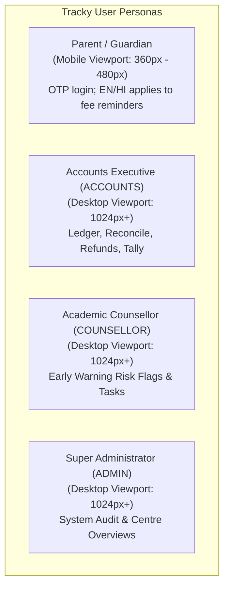

# Tracky (Payshift) — Frontend Blueprint: Routes, Cards & Button Action Catalog

**Document Target:** Frontend Implementation & Component Design  
**Framework:** Next.js 16 App Router, TypeScript, Tailwind CSS v4, Lucide Icons  
**Reference Specification:** [`docs/HLD.md`](./HLD.md) and [`README.md`](../README.md)

> **Status: route and workflow inventory.** As of 2026-11-08, implemented pages include marketing routes `/`, `/product`, `/for-parents`, and the branded not-found page, plus `/login`, `/signup`, `/dashboard`, `/dashboard/unmatched`, `/dashboard/refunds`, `/dashboard/tally`, `/counsellor`, `/parent/dues`, `/parent/preferences`, and the development-only `/checkout/mock`. Accounts and counsellors can use their review workflows; parent fee payments use Razorpay when configured and a non-charging simulated checkout in development. Parents can choose English or Hindi for fee reminders; this does not localize the site. Consent capture remains pending because signup does not create a consent record. The export backend currently downloads CSV for accounting handoff; it does not sync to Tally. Landing page dropdown links target live product sections; dedicated product and parent guides provide static destinations, and unknown routes lead to the not-found page.

---

## Table of Contents

1. [Architecture & Persona Taxonomy](#1-architecture--persona-taxonomy)
2. [Master Backend API Route Tracker](#2-master-backend-api-route-tracker)
3. [Frontend Page Route Architecture](#3-frontend-page-route-architecture)
4. [Master Button & Action Catalog](#4-master-button--action-catalog)
   - [A. Authentication Actions](#a-authentication-actions)
   - [B. Parent Self-Service Portal Actions](#b-parent-self-service-portal-actions)
   - [C. Accounts: Dues Dashboard & Tally Actions](#c-accounts-dues-dashboard--tally-actions)
   - [D. Accounts: Unmatched Payments Queue Actions](#d-accounts-unmatched-payments-queue-actions)
   - [E. Accounts: Fee Refunds Pipeline Actions](#e-accounts-fee-refunds-pipeline-actions)
   - [F. Counsellor: Dropout-Risk & Tasks Actions](#f-counsellor-dropout-risk--tasks-actions)
5. [Frontend Cards & Widget Inventory](#5-frontend-cards--widget-inventory)
   - [1. Parent Portal Cards](#1-parent-portal-cards)
   - [2. Accounts Executive Cards](#2-accounts-executive-cards)
   - [3. Counsellor & Risk Cards](#3-counsellor--risk-cards)
6. [Modals & Overlay Dialogs](#6-modals--overlay-dialogs)
7. [Semantic Status Badges & Design Tokens](#7-semantic-status-badges--design-tokens)

---

## 1. Architecture & Persona Taxonomy

Tracky is strictly partitioned into **three functional personas** with distinct UX requirements and permission boundaries:



| Persona | Primary Needs | Viewport | Auth Method | Guards |
| :--- | :--- | :--- | :--- | :--- |
| **Parent / Guardian** | View dues, pay instalments with 1 tap, download GST receipts for multiple wards | Mobile-first (360px+) | 6-digit phone OTP | `requireParent()` (Anti-IDOR) |
| **Accounts Staff** | Track ageing dues, resolve unmatched bank transfers, process refunds, export receipt CSV for accounting handoff | Desktop (1024px+) | Email + Password | `requireStaff(["ACCOUNTS", "ADMIN"])` |
| **Counsellor Staff** | Review automated dropout risk signals, manage outreach worklist, log call notes | Desktop (1024px+) | Email + Password | `requireStaff(["COUNSELLOR", "ADMIN"])` |
| **Administrator** | Multi-centre rollups, staff role governance, system audit trails, manual cron triggers | Desktop (1024px+) | Email + Password | `requireStaff(["ADMIN"])` |

---

## 2. Master Backend API Route Tracker

This table lists current API endpoints and their UI consumers. Verify exact request and response details against the route handler when extending a workflow.

| Method | Endpoint | Access Guard | Request Payload / Params | Key Response Fields | Frontend Consumer / Trigger |
| :--- | :--- | :--- | :--- | :--- | :--- |
| `POST` | `/api/auth/otp/send` | Public | `{ phone: "+91..." }` | `{ success: true, message: string }` | Parent Login & Signup OTP cards |
| `POST` | `/api/auth/otp/verify` | Public | `{ phone: "+91...", otp: "123456" }` | Session/auth result; unregistered guardians continue to signup | Parent OTP verification card |
| `POST` | `/api/auth/signup` | Public | `{ name, phone, otp?, email?, studentId?, relation?, preferredLang? }` | Session/auth result | Parent signup form; consent is not currently captured by this endpoint |
| `POST` | `/api/auth/login` | Public | `{ email, password }` | `{ success: true, user: StaffUser }` | Staff Login credentials form |
| `POST` | `/api/auth/logout` | Authenticated | None | `{ success: true }` | Navigation Header Logout button |
| `GET` | `/api/auth/me` | Authenticated | None | `{ success: true, user: UserProfile }` | Global App Shell & Session Provider |
| `GET` | `/api/parent/dues` | `requireParent` | None | `{ students: Array<StudentDues> }` | Parent Dues Overview page |
| `POST` | `/api/parent/instalments/:id/pay` | `requireParent` | `params: { instalmentId }` | `{ success, orderId, gatewayOrderId, checkoutUrl, checkout, amountPaise }` | Parent instalment checkout button |
| `POST` | `/api/parent/instalments/:id/pay/verify` | `requireParent` | `{ razorpay_order_id, razorpay_payment_id, razorpay_signature }` | `{ status: "PAID" \| "CONFIRMING" \| "FAILED" \| "UNDER_REVIEW", receiptNo? }` | Razorpay checkout callback |
| `GET` | `/api/parent/receipts` | `requireParent` | None | `{ receipts: Array<ReceiptListItem> }` | Parent Receipts History card |
| `GET` | `/api/parent/receipts/:id` | `requireParent` | `params: { id: receiptId }` | Standalone HTML with CSP headers | "View Receipt" / "Print" button |
| `GET`, `PATCH` | `/api/parent/preferences` | `requireParent` | `{ preferredLang: "EN" \| "HI" }` for PATCH | Current or updated reminder language | Parent message preferences page |
| `GET` | `/api/staff/dues` | `ACCOUNTS`, `ADMIN` | `query: ?centreId=&asOf=YYYY-MM-DD` | `{ asOf, summary: AgingBuckets, centres, students }` | Accounts Dues Dashboard |
| `GET` | `/api/staff/tally-exports` | `ACCOUNTS`, `ADMIN` | `query: ?from=YYYY-MM-DD&to=YYYY-MM-DD` | CSV attachment; centre scope comes from session for staff | Receipt export page |
| `GET` | `/api/staff/enrollments` | `ACCOUNTS`, `ADMIN` | Optional `?q=` search | Centre-scoped enrollments, student and batch labels | Refund initiation form |
| `GET` | `/api/staff/unmatched-payments` | `ACCOUNTS`, `ADMIN` | None | `{ success: true, count, payments }` | Unmatched Payments Queue table |
| `POST` | `/api/staff/unmatched-payments/:id/match` | `ACCOUNTS`, `ADMIN` | `{ studentId: "STU-XXXX" }` | `{ success: true, receiptNo, allocations }` | "Confirm Match" modal button |
| `POST` | `/api/staff/unmatched-payments/:id/reject` | `ACCOUNTS`, `ADMIN` | `{ reason: string }` | `{ success: true, status: "REJECTED" }` | "Reject Payment" modal button |
| `GET` | `/api/staff/refunds` | `ACCOUNTS`, `ADMIN` | `query: ?status=PENDING` | `{ cases: Array<RefundCaseListItem> }` | Refunds Management pipeline view |
| `POST` | `/api/staff/refunds` | `ACCOUNTS`, `ADMIN` | `{ enrollmentId, reasonCode, reasonDetail }` | `{ success: true, case: RefundCaseDetail }` | "Initiate Refund" modal button |
| `POST` | `/api/staff/refunds/:id` | `ACCOUNTS`, `ADMIN` | `{ action: "approve" \| "reject" \| "settle" }` | `{ success: true, case: RefundCaseDetail }` | Refund Action buttons (`Approve`, etc.) |
| `GET` | `/api/staff/risk-flags/metrics` | `COUNSELLOR`, `ADMIN` | `query: ?centreId=&windowDays=30` | `{ total, high, medium, precisionRate, ... }` | Risk Analytics KPI banner |
| `GET` | `/api/staff/risk-flags` | `COUNSELLOR`, `ADMIN` | `query: ?status=OPEN&tier=HIGH` | Centre-scoped list of flags and linked tasks | Counsellor risk review list |
| `POST` | `/api/staff/risk-flags/:id/review` | `COUNSELLOR`, `ADMIN` | `{ status: "CONFIRMED" \| "FALSE_FLAG", reason, note }` | `{ success: true, flag: RiskFlagDetail }` | "Mark Valid" / "False Flag" buttons |
| `GET` | `/api/staff/counsellor-tasks` | `COUNSELLOR`, `ADMIN` | `query: ?status=OPEN&mine=true` | `{ tasks: Array<CounsellorTaskItem> }` | Counsellor Worklist table/cards |
| `PATCH` | `/api/staff/counsellor-tasks/:id` | `COUNSELLOR`, `ADMIN` | `{ status?, notes?, assigneeId? }` | `{ success: true, task: CounsellorTaskDetail }` | "Update Task" / "Assign to Me" buttons |
| `POST` | `/api/webhooks/payments` | Public (Signed) | Raw JSON payload + Signature header | Webhook processing result | Payment gateway webhook trigger |
| `POST` | `/api/parent/checkout/mock` | `requireParent`, development mock only | `{ orderId }` | Mock payment settlement result | Local simulated checkout page |
| `POST` | `/api/webhooks` | Public (Signed) | Request payload/signature per handler | Handler-specific result | Additional webhook handler |
| `GET`, `POST` | `/api/cron` | `CRON_SECRET` | Header: `Authorization: Bearer <secret>` | Reminder summary and risk evaluation result | Daily job; development-only `?date=YYYY-MM-DD` override |

---

## 3. Frontend Page Route Architecture

Current Next.js App Router pages and workflow screens:

```text
src/app/
├── page.tsx                         # Implemented marketing landing page + free tools/demo
├── (auth)/login/page.tsx            # Implemented parent OTP / staff password tabs
├── (auth)/signup/page.tsx           # Implemented parent signup; consent capture pending
├── parent/dues/page.tsx             # Dues, receipts and checkout actions
├── parent/preferences/page.tsx      # English/Hindi fee-reminder preference
├── checkout/mock/page.tsx           # Development-only simulated checkout
├── dashboard/page.tsx               # Accounts overview
├── dashboard/unmatched/page.tsx     # Match/reject unmatched transfers
├── dashboard/refunds/page.tsx       # Preview, open and transition refund cases
├── dashboard/tally/page.tsx         # Download date-scoped receipt CSV
└── counsellor/page.tsx              # Review risk flags; assign and update tasks
```

Consent collection and a parent-facing reminder-language settings page remain unimplemented. Language can currently be selected during signup. Receipt pages open as standalone printable HTML; users can use the browser's print command.

---

## 4. Master Button & Action Catalog

Current and planned actions, with target API, payload, and UI states:

### A. Authentication Actions

The entries below describe current and planned UI behavior. Parent signup currently does not record consent.

| Button Label | Icon | Variant | API Route & Method | Payload Sent | State & Feedback |
| :--- | :--- | :--- | :--- | :--- | :--- |
| **Send OTP** | `Send` | Primary | `POST /api/auth/otp/send` | `{ phone }` | Disables input for 60s; displays countdown timer; focus moves to OTP input. |
| **Verify & Enter** | `LogIn` | Primary | `POST /api/auth/otp/verify` | `{ phone, otp }` | Loading spinner; on success redirects to `/parent/dues`. Toast on error. |
| **Resend OTP** | `RefreshCw` | Ghost | `POST /api/auth/otp/send` | `{ phone }` | Active only after 60s countdown; resets cooldown. |
| **Create Account** | `UserPlus` | Primary | `POST /api/auth/signup` | `{ name, phone, otp?, email?, studentId?, relation?, preferredLang? }` | Signup endpoint creates a guardian session and `/parent/dues` exists. Consent capture is still pending. |
| **Staff Sign In** | `KeyRound` | Primary | `POST /api/auth/login` | `{ email, password }` | Role-based redirect (`ACCOUNTS` $\rightarrow$ `/dashboard/dues`, `COUNSELLOR` $\rightarrow$ `/dashboard/tasks`). |
| **Sign Out** | `LogOut` | Ghost / Red | `POST /api/auth/logout` | None | Clears session cookie; redirects to `/login`. |
| **Reminder Language Preference (EN/HI)** | `Languages` | Select | `POST /api/auth/signup` | `preferredLang: "EN" | "HI"` | Chosen at parent signup; affects reminder messages and does not localize the website. |

---

### B. Parent Self-Service Portal Actions

| Button Label | Icon | Variant | API Route & Method | Payload Sent | State & Feedback |
| :--- | :--- | :--- | :--- | :--- | :--- |
| **Pay Now (₹XX,XXX)** | `CreditCard` | Primary (Green) | `POST /api/parent/instalments/:id/pay` | None (Instalment ID in URL) | Opens Razorpay Checkout sheet or redirects to Mock checkout URL. Button shows loading state while creating order. |
| **Confirm Payment** | `CheckCircle` | Primary | `POST /api/parent/instalments/:id/pay/verify` | `{ razorpay_order_id, razorpay_payment_id, razorpay_signature }` | Called by checkout callback handler; shows payment success modal with receipt button. |
| **View Receipt** | `FileText` | Outline | `GET /api/parent/receipts/:id` | None (Receipt ID in URL) | Opens standalone printable GST receipt in new browser tab. |
| **Download PDF / Print** | `Printer` | Primary | Client `window.print()` | None | Triggers browser system print dialog formatted for receipt media. |
| **Switch Child (Ward Tab)** | `Users` | Pill / Tab | Client Filter | `studentId` | Switches active student dues view if guardian has multiple children in institute. |
| **Refresh Dues** | `RefreshCcw` | Ghost | `GET /api/parent/dues` | None | SWR / React Query cache revalidation with spinning icon. |

---

### C. Accounts: Dues Dashboard & Tally Actions

| Button Label | Icon | Variant | API Route & Method | Payload Sent | State & Feedback |
| :--- | :--- | :--- | :--- | :--- | :--- |
| **Apply Filters** | `Filter` | Primary | `GET /api/staff/dues` | `?centreId=&asOf=` | Updates aging summary cards and re-renders student dues table. |
| **Reset Filters** | `RotateCcw` | Ghost | `GET /api/staff/dues` | Defaults | Clears date picker and centre dropdown back to current date & all centres. |
| **Export receipt CSV** | `Download` | Primary | `GET /api/staff/tally-exports` | `?from=YYYY-MM-DD&to=YYYY-MM-DD` | Downloads matched receipts as CSV for an accounting handoff; no live Tally sync. |
| **View Student Ledger** | `ExternalLink` | Ghost | Client Drawer | `studentId` | Opens side drawer displaying complete student payment history & fee breakdown. |
| **Export Dues CSV** | `FileSpreadsheet` | Secondary | Client CSV Export | Filtered rows | Exports current dues table view into CSV for offline executive follow-up. |

---

### D. Accounts: Unmatched Payments Queue Actions

| Button Label | Icon | Variant | API Route & Method | Payload Sent | State & Feedback |
| :--- | :--- | :--- | :--- | :--- | :--- |
| **Match to Student** | `UserCheck` | Primary (Blue) | Opens Match Modal | `paymentId` | Opens matching modal showing payment amount, UTR, and student search bar. |
| **Confirm Match** | `Check` | Primary (Emerald) | `POST /api/staff/unmatched-payments/:id/match` | `{ studentId }` | Validates target student; generates locked GST receipt; removes row from queue. |
| **Reject Payment** | `XCircle` | Destructive (Red) | Opens Reject Modal | `paymentId` | Opens confirmation modal requesting mandatory rejection reason. |
| **Confirm Rejection** | `Trash2` | Destructive | `POST /api/staff/unmatched-payments/:id/reject` | `{ reason }` | Marks status as `REJECTED`; permanently logs rejection in audit trail. |
| **Copy UTR / Gateway Ref** | `Copy` | Ghost | Clipboard API | `gatewayRef` | Copies bank transfer UTR to clipboard; displays "Copied!" tooltip. |

---

### E. Accounts: Fee Refunds Pipeline Actions

| Button Label | Icon | Variant | API Route & Method | Payload Sent | State & Feedback |
| :--- | :--- | :--- | :--- | :--- | :--- |
| **Initiate Refund** | `Plus` | Primary | Opens Refund Modal | None | Opens enrollment selection drawer with step-by-step pro-rata calculation preview. |
| **Calculate Refund Preview** | `Calculator` | Secondary | Client Calculation | `enrollmentId, reasonCode` | Computes cooling-off qualification, registration fee retention, and pro-rata tuition refund. |
| **Submit Refund Request** | `Send` | Primary | `POST /api/staff/refunds` | `{ enrollmentId, reasonCode, reasonDetail }` | Submits case with status `PENDING` (`reasonDetail` required if `reasonCode` is `OTHER`); displays case ID toast. |
| **Approve Refund** | `ThumbsUp` | Primary (Blue) | `POST /api/staff/refunds/:id` | `{ action: "approve" }` | Advances `PENDING` case to `APPROVED`; stamps `approvedById` and sets 10-day settlement SLA deadline. |
| **Reject Refund** | `ThumbsDown` | Destructive | `POST /api/staff/refunds/:id` | `{ action: "reject" }` | Moves `PENDING` case to `REJECTED`; prompts for review notes. |
| **Mark Settled** | `CheckCheck` | Primary (Green) | `POST /api/staff/refunds/:id` | `{ action: "settle" }` | Advances case to `SETTLED`. Shown only for `APPROVED` cases, displaying paid vs refund amounts. Validates refund does not exceed paid minus already settled; no bank reference required. |

---

### F. Counsellor: Dropout-Risk & Tasks Actions

| Button Label | Icon | Variant | API Route & Method | Payload Sent | State & Feedback |
| :--- | :--- | :--- | :--- | :--- | :--- |
| **Review Risk Flag** | `AlertTriangle` | Outline | Opens Review Modal | `flagId` | Opens modal with multi-signal score breakdown and explainable summary. |
| **Confirm Risk** | `Check` | Primary | `POST /api/staff/risk-flags/:id/review` | `{ status: "CONFIRMED" }` | Confirms flag; creates/promotes counsellor task whose priority is derived from flag tier. |
| **Mark False Flag** | `X` | Secondary / Amber | `POST /api/staff/risk-flags/:id/review` | `{ status: "FALSE_FLAG", reason, note }` | Requires selecting reason (`MEDICAL_LEAVE`, `FEE_ARRANGEMENT_AGREED`, etc.) for audit. |
| **Assign to Me** | `UserPlus` | Secondary | `PATCH /api/staff/counsellor-tasks/:id` | `{ assigneeId: currentUserId }` | Assigns outreach task to logged-in counsellor; updates worklist immediately. |
| **Start Outreach** | `Play` | Outline | `PATCH /api/staff/counsellor-tasks/:id` | `{ status: "IN_PROGRESS" }` | Updates task status to `IN_PROGRESS`; opens notes editor. |
| **Resolve Task** | `CheckCircle2` | Primary (Green) | `PATCH /api/staff/counsellor-tasks/:id` | `{ status: "RESOLVED", notes }` | Closes task with parent resolution summary (e.g. "Payment agreed by Friday"). |
| **Dismiss Task** | `Archive` | Ghost | `PATCH /api/staff/counsellor-tasks/:id` | `{ status: "DISMISSED", notes }` | Dismisses task if student already supported or transferred. |
| **Filter My Tasks** | `User` | Pill / Toggle | `GET /api/staff/counsellor-tasks` | `?mine=true` | Toggles between centre-wide tasks and current counsellor's assigned worklist. |

---

## 5. Frontend Cards & Widget Inventory

### 1. Parent Portal Cards

```
+-------------------------------------------------------------+
| [Ward Tabs] [Aarav Sharma - JEE 2027]  [Pooja Sharma - NEET] |
+-------------------------------------------------------------+
| CARD 1: Student Financial Health Banner                    |
| Next Due: 10 Nov 2026 | Overdue: ₹15,000 | Status: OVERDUE  |
| [PAY TOTAL DUES: ₹15,000]                                   |
+-------------------------------------------------------------+
| CARD 2: Active Instalments Breakdown Card                  |
| - Instalment 1: ₹15,000  • Due 10 Aug 2026  [PAID - RCP-01]  |
| - Instalment 2: ₹15,000  • Due 10 Oct 2026  [PAY NOW] (Red)  |
+-------------------------------------------------------------+
| CARD 3: Recent GST Receipts Card                           |
| - 08 Aug 2026: ₹15,000 • RCP-2026-KOT-0001 [VIEW RECEIPT]   |
+-------------------------------------------------------------+
```

#### Card 1: Student Financial Health Banner
* **Purpose**: Hero summary on parent login giving immediate clarity on what is owed.
* **Fields**:
  * Ward Name & Enrolled Batch (`Aarav Sharma — JEE 2027 Kota`)
  * Total Net Fee (`₹30,000.00`)
  * Total Paid Amount (`₹15,000.00`)
  * Total Outstanding Balance (`₹15,000.00`)
  * Overdue Alert Tag (`23 Days Overdue` in red badge)
* **Primary Action**: Sticky high-contrast `[PAY NOW: ₹15,000]` button.

#### Card 2: Active Instalments Schedule Card
* **Purpose**: Detailed list of scheduled payments and their historical status.
* **Fields per Instalment Row**:
  * Instalment Seq & Label (`Instalment 2 of 2`)
  * Due Date in IST (`Due 10 Oct 2026`)
  * Grace Period info (`3 days grace period`)
  * Total Amount (`₹15,000.00`)
  * Status Badge (`PAID`, `UPCOMING`, `OVERDUE`)
* **Actions per Row**:
  * If Unpaid: `[Pay Now]` button.
  * If Paid: `[View Receipt]` link button.

#### Card 3: Recent Receipts History Card
* **Purpose**: Access to all past payments and official GST receipts for tax/school records.
* **Fields per Receipt Row**:
  * Receipt Number (`RCP-2026-KOT-0042`)
  * Payment Date (`08 Aug 2026`)
  * Mode & Reference (`Online UPI • pay_98124`)
  * Total Amount Paid (`₹15,000.00`)
* **Actions per Row**: `[View Receipt]` (opens printable HTML view).

---

### 2. Accounts Executive Cards

```
+-----------------------------------------------------------------------------------+
| CARD 4: Institute Dues KPI Banner                                                 |
| [Total Dues: ₹24.5L]  [0-30d: ₹12.0L]  [31-60d: ₹6.5L]  [61-90d: ₹4.0L] [90+d: 2L] |
+-----------------------------------------------------------------------------------+
| CARD 5: Dues Filter & Table Card                                                  |
| Filter: [Centre: Kota v] [As Of: 2026-11-06] [Export CSV]                         |
| Student ID | Student Name | Batch    | Total Due | Days Overdue | Bucket | Action |
| STU-0587   | Aarav Sharma | JEE 2027 | ₹15,000   | 23 Days      | 0-30d  | [View] |
+-----------------------------------------------------------------------------------+
| CARD 6: Unmatched Payments Queue Card (3 pending)                                 |
| UTR / Gateway Ref | Amount  | Date        | Source | Actions                      |
| neft_axis_98124   | ₹12,000 | 05 Nov 2026 | NEFT   | [MATCH TO STUDENT] [REJECT]  |
+-----------------------------------------------------------------------------------+
| CARD 7: Tally ERP 9 Voucher Export Card                                           |
| Date Range: [From Date] to [To Date] • Centre: [Kota Main v] • [EXPORT TALLY XML] |
+-----------------------------------------------------------------------------------+
```

#### Card 4: Institute Dues KPI Banner
* **Purpose**: High-level financial posture showing institute-wide and bucketed exposure.
* **Widgets**:
  * Total Outstanding Fees Metric Card
  * 0–30 Days (Current Overdue) Metric Card
  * 31–60 Days (Moderate Overdue) Metric Card
  * 61–90 Days (Severe Overdue) Metric Card
  * 90+ Days (Critical / Doubtful Overdue) Metric Card

#### Card 5: Aging Dues Ledger Table Card
* **Purpose**: Primary operational table for accounts teams to follow up on outstanding instalments.
* **Columns**: Student ID, Name, Batch, Centre, Total Outstanding (`₹`), Days Overdue, Aging Bucket Tag, Actions (`[View Ledger]`, `[Copy Contact]`).
* **Filters**: Search by Student ID/Name, Centre dropdown, Batch dropdown, Aging Bucket multi-select.

#### Card 6: Unmatched Payments Queue Card
* **Purpose**: Zero-orphan reconciliation table for direct NEFT/RTGS/UPI transfers received without student references.
* **Columns**: Transaction Ref / UTR, Amount (`₹`), Date & Time Received, Payment Source (`NEFT`, `IMPS`, `UPI`), Notes.
* **Actions**: `[Match to Student]` (launches match modal), `[Reject Payment]` (launches reject modal).

#### Card 7: Receipt CSV Export Card
* **Purpose**: Download reconciled receipts for an accounting handoff.
* **Controls**: From Date picker, To Date picker, `[Download CSV export]` primary button. Centre scope is enforced by the staff session; administrators can export across centres.

---

### 3. Counsellor & Risk Cards

```
+-----------------------------------------------------------------------------------+
| CARD 8: Early Warning Dropout Diagnostics Banner                                  |
| [High Risk: 8]  [Medium Risk: 14]  [Open Tasks: 12]  [Intervention Accuracy: 84%]  |
+-----------------------------------------------------------------------------------+
| CARD 9: Student Risk Flag Card                                                    |
| Student: STU-0587 (Aarav Sharma) • Batch: JEE 2027 • Centre: Kota                  |
| Risk Score: [78 / 100 - HIGH RISK (Red)]                                          |
| Corroborating Signals:                                                            |
| [!] Fee Overdue: 23 days past grace period                                        |
| [!] Attendance Drop: 4 consecutive missed lectures this week                      |
| [!] Academic Score: Down 24% in latest Mock Physics test                          |
| Plain-English Summary: "Student has combined 23-day fee delay with a sharp        |
| attendance decline and test score drop over the past 14 days."                   |
| Actions: [CONFIRM RISK]  [MARK FALSE FLAG]                                        |
+-----------------------------------------------------------------------------------+
| CARD 10: Counsellor Outreach Worklist Card                                        |
| Filter: [Show: All Tasks v] [My Assigned Tasks (Toggle)]                          |
| Student         | Batch     | Priority | Stage       | Assignee    | Action          |
| Aarav Sharma    | JEE 2027  | High     | IN_PROGRESS | Dr. Rajesh  | [LOG NOTES / RESOLVE] |
+-----------------------------------------------------------------------------------+
```

#### Card 8: Early Warning Dropout Diagnostics Banner
* **Purpose**: Real-time snapshot of academic drop-out risks across active students.
* **Widgets**: High Risk Count Badge, Medium Risk Count Badge, Active Outreach Tasks Count, Positive Intervention Accuracy Rate.

#### Card 9: Student Risk Flag Card
* **Purpose**: Explainable, ethical diagnostic card for a flagged student.
* **Signals Displayed**:
  * Fee Signal Tile: Overdue days and outstanding amount.
  * Attendance Signal Tile: Lookback percentage & consecutive absence streak.
  * Academic Signal Tile: Test score trend & percentage drop.
  * Plain-English Explainability Box: Transparent rationale for why the flag triggered.
* **Actions**: `[Confirm Risk]` (creates/promotes outreach task), `[Mark False Flag]` (opens audit modal).

#### Card 10: Counsellor Outreach Worklist Card
* **Purpose**: Task board for student counsellors to log guardian calls and resolutions. Rows are identified by student name + batch (no Task ID column).
* **Columns**: Student Name, Batch, Priority (`High`, `Medium`, `Normal`), Assignee, Outreach Status (`OPEN`, `IN_PROGRESS`, `RESOLVED`, `DISMISSED`), Notes summary.
* **Actions**: `[Assign to Me]`, `[Update Status]`, `[Log Resolution Notes]`.

---

## 6. Modals & Overlay Dialogs

### Modal 1: Manual Payment Matching Modal
* **Triggered by**: `[Match to Student]` button on Unmatched Payments card.
* **Inputs**:
  * Student Search Bar (auto-completes student ID or student name).
* **Live Calculation Displayed**:
  * Current Student Outstanding: `₹15,000`
  * Unmatched Payment Amount: `₹12,000`
  * Allocation Preview: Oldest instalment `inst_0587_2` receives `₹12,000` (Remaining: `₹3,000`).
* **Buttons**:
  * `[Confirm & Allocate Payment]` (Primary Green) $\rightarrow$ Calls `POST /api/staff/unmatched-payments/:id/match`.
  * `[Cancel]` (Ghost).

### Modal 2: Reject Unmatched Payment Modal
* **Triggered by**: `[Reject Payment]` button on Unmatched Payments card.
* **Inputs**:
  * Rejection Reason input (e.g. "Unknown depositor; returned by bank").
* **Warning Notice**: "This payment will be marked REJECTED and kept in the permanent ledger. Financial records are never deleted."
* **Buttons**:
  * `[Confirm Rejection]` (Destructive Red) $\rightarrow$ Calls `POST /api/staff/unmatched-payments/:id/reject`.
  * `[Cancel]` (Ghost).

### Modal 3: Initiate Refund Request Modal
* **Triggered by**: `[Initiate Refund]` button on Refunds page.
* **Inputs**:
  * Enrollment ID selector.
  * Reason Code Dropdown (`STUDENT_WITHDRAWAL`, `BATCH_CANCELLED`, `MEDICAL_GROUNDS`, `DOUBLE_PAYMENT`, `OTHER`).
  * Detailed Notes textarea.
* **Step-by-Step Policy Breakdown Preview**:
  1. Total Course Fee Paid: `₹20,000`
  2. Non-Refundable Registration Fee: `-₹5,000`
  3. Pro-Rata Tuition Deduction: `-₹3,200` (40 of 250 days elapsed)
  4. **Eligible Refund Amount: ₹11,800.00**
* **Buttons**:
  * `[Submit Refund Case]` (Primary) $\rightarrow$ Calls `POST /api/staff/refunds`.
  * `[Cancel]` (Ghost).

### Modal 4: False-Flag Review Audit Modal
* **Triggered by**: `[Mark False Flag]` button on Risk Flag card.
* **Inputs**:
  * Mandatory Reason Dropdown (`MEDICAL_LEAVE`, `FEE_ARRANGEMENT_AGREED`, `FAMILY_EVENT`, `DATA_ERROR`, `ALREADY_SUPPORTED`, `OTHER`).
  * Optional explanation note.
* **Buttons**:
  * `[Confirm False Flag]` (Amber) $\rightarrow$ Calls `POST /api/staff/risk-flags/:id/review`.
  * `[Cancel]` (Ghost).

---

## 7. Semantic Status Badges & Design Tokens

Use these uniform badge colors and micro-copy across all frontend cards:

### Payment & Order Status

| Status | Color Token | Tailwind Classes | User Label |
| :--- | :--- | :--- | :--- |
| `PAID` / `MATCHED` | Emerald Green | `bg-emerald-50 text-emerald-700 border-emerald-200` | Paid / Reconciled |
| `CREATED` / `UPCOMING` | Neutral Gray | `bg-slate-50 text-slate-600 border-slate-200` | Upcoming |
| `UNMATCHED` | Amber Yellow | `bg-amber-50 text-amber-700 border-amber-200` | Unmatched / Action Needed |
| `FAILED` / `OVERDUE` | Rose Red | `bg-rose-50 text-rose-700 border-rose-200` | Overdue / Failed |
| `REJECTED` | Stone Slate | `bg-stone-100 text-stone-600 border-stone-200` | Rejected |

### Dropout Risk Tiers

| Tier | Score Range | Color Token | Tailwind Classes |
| :--- | :--- | :--- | :--- |
| `LOW` | 0 – 39 | Green | `bg-emerald-50 text-emerald-700 border-emerald-200` |
| `MEDIUM` | 40 – 69 | Amber | `bg-amber-50 text-amber-700 border-amber-200` |
| `HIGH` | 70 – 100 | Crimson Red | `bg-rose-100 text-rose-800 border-rose-300 font-semibold` |

### Counsellor Worklist Priority Badges

Priority is derived on the fly from the linked `RiskFlag`:
* `HIGH` risk tier $\rightarrow$ **High**
* `MEDIUM` risk tier $\rightarrow$ **Medium**
* `LOW` risk tier or no flag $\rightarrow$ **Normal**

| Priority | Tailwind Classes | Description |
| :--- | :--- | :--- |
| `High` | `bg-rose-100 text-rose-800 border-rose-300` | Critical intervention required; sorted first |
| `Medium` | `bg-amber-50 text-amber-700 border-amber-200` | Elevated dropout risk |
| `Normal` | `bg-slate-50 text-slate-600 border-slate-200` | Standard follow-up |

### Counsellor Task Status

| Status | Tailwind Classes | Description |
| :--- | :--- | :--- |
| `OPEN` | `bg-blue-50 text-blue-700 border-blue-200` | New task awaiting assignment |
| `IN_PROGRESS` | `bg-amber-50 text-amber-700 border-amber-200` | Counsellor outreach underway |
| `RESOLVED` | `bg-emerald-50 text-emerald-700 border-emerald-200` | Student situation addressed |
| `DISMISSED` | `bg-slate-50 text-slate-500 border-slate-200` | Closed without intervention |

### Refund Case Status

| Status | Tailwind Classes | Description |
| :--- | :--- | :--- |
| `PENDING` | `bg-amber-50 text-amber-700 border-amber-200` | Awaiting accounts approval |
| `APPROVED` | `bg-blue-50 text-blue-700 border-blue-200` | Approved; within 10-day settlement SLA |
| `SETTLED` | `bg-emerald-50 text-emerald-700 border-emerald-200` | Marked settled in the system (no bank payout integration) |
| `REJECTED` | `bg-rose-50 text-rose-700 border-rose-200` | Request denied by management |

